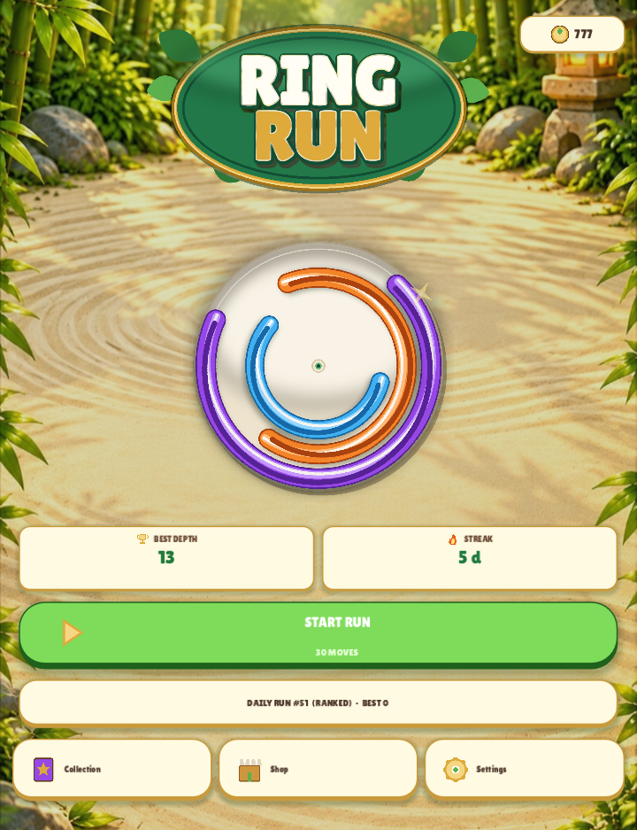
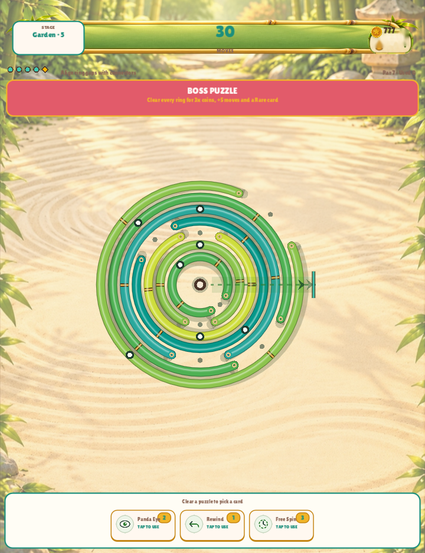
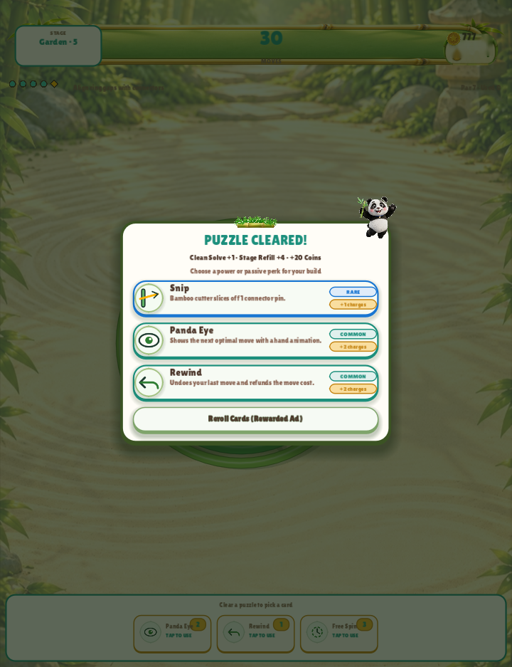
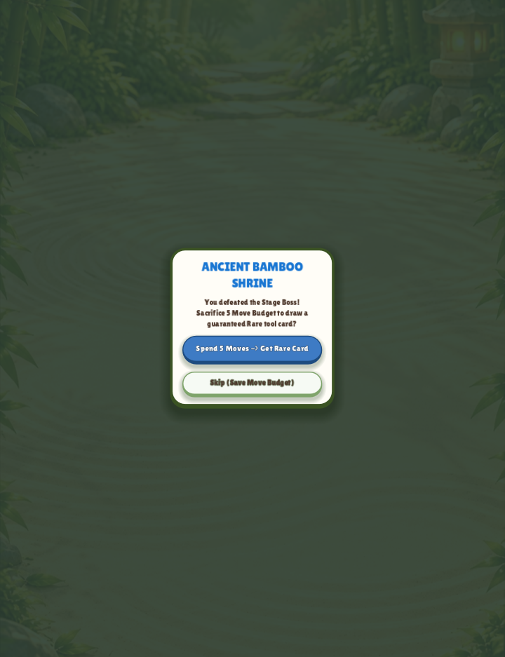
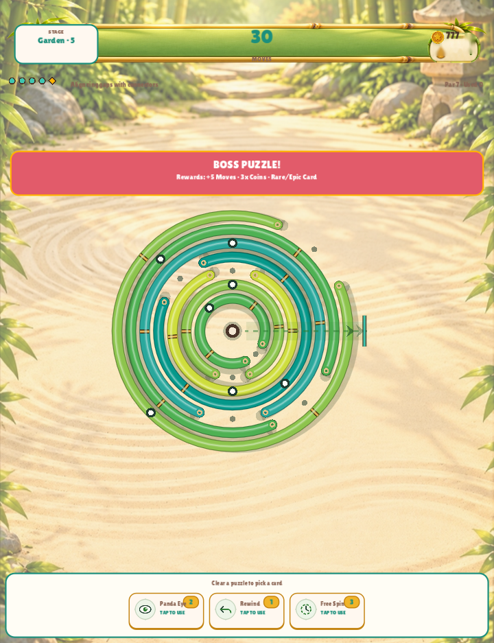
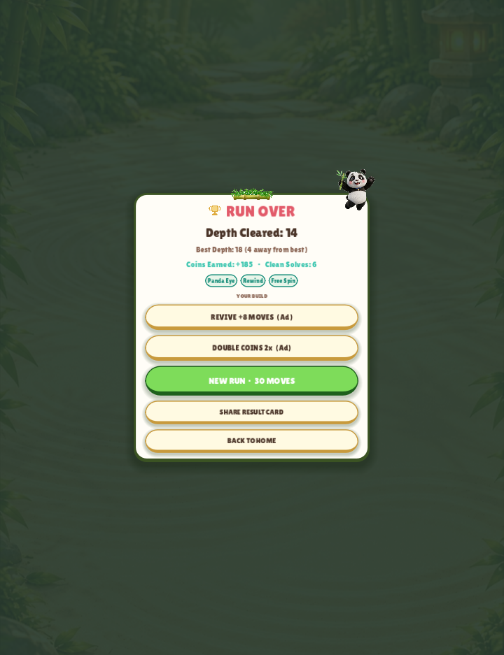
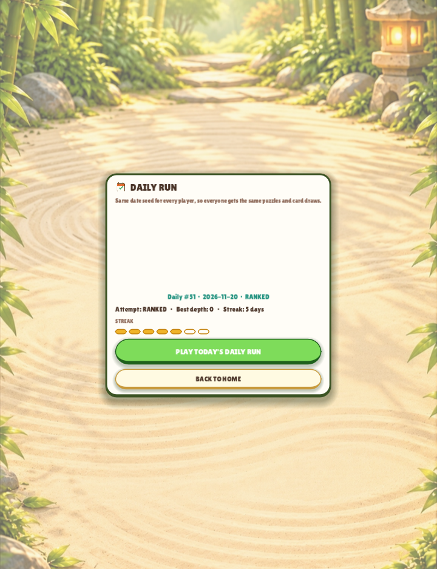
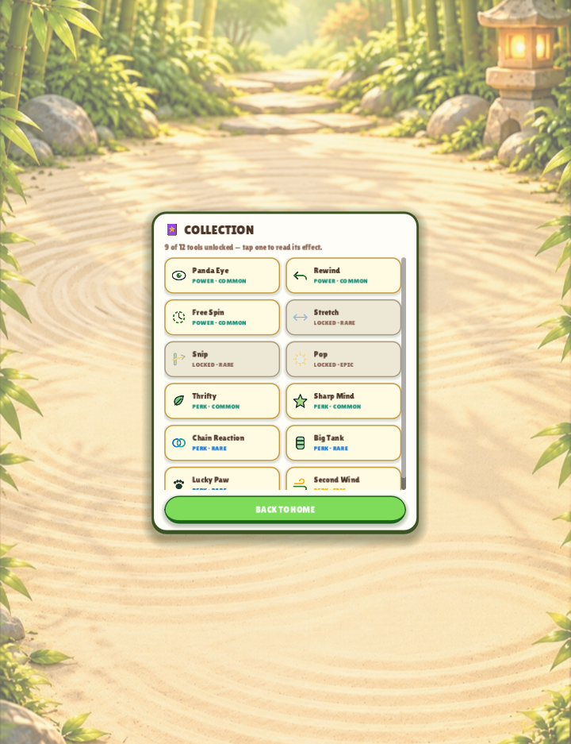
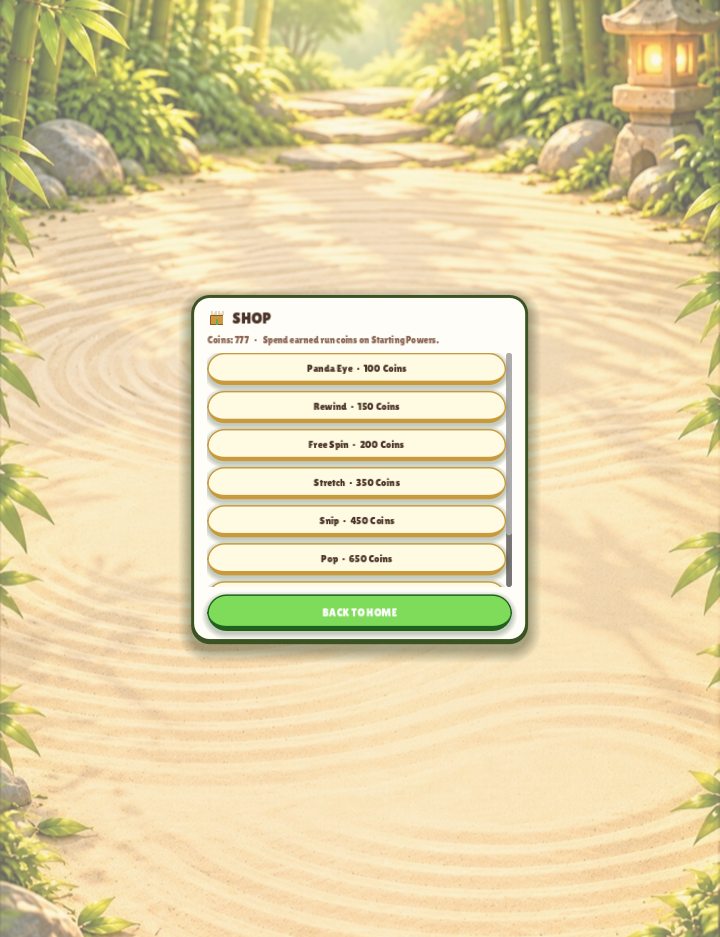
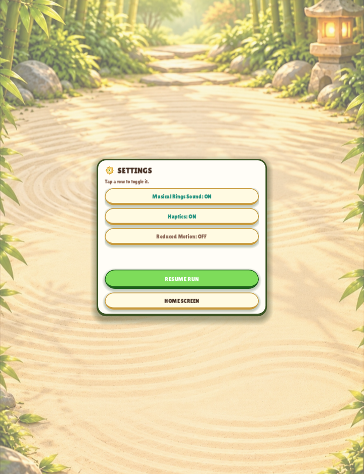

# Ring Run 🎋

> **One move budget. Endless ring puzzles. A new build every run.**

A roguelike re-skin of the Rotate Rings puzzle game, built with **Godot 4.7.2** (pure GDScript, GL Compatibility renderer).

Instead of walking a fixed list of levels, you get one pool of moves for the whole run. Every ring you turn spends one. Every puzzle you clear gives some back. When the budget hits zero the run is over — and how deep you got is the score.



---

## 🤖 Antigravity Agent Takeover Prompt

If you are an **Antigravity agent** or AI developer taking over this project, copy and paste the block below into your session to start immediately:

```markdown
You are taking over development of an EXISTING Godot 4.7.2 game called "Ring Run".
Continue the work that is already in progress — do NOT start a new game, do NOT rewrite the project, and do NOT copy code from neighboring folders.

## 1. WORKSPACE LOCATION — MANDATORY RULE
Work ONLY in:
  /Users/radhikamac/Desktop/RingRun 2

There are two other folders on Desktop:
  /Users/radhikamac/Desktop/RotateRings  <- Older, different game. READ-ONLY for engine reference. NEVER edit or copy code from it (class names collide).
  /Users/radhikamac/Desktop/RingRun      <- Stale duplicate. When you finish work, sync RingRun 2 -> RingRun via rsync.

Confirm your working directory is /Users/radhikamac/Desktop/RingRun 2 and that project.godot has config/name="Ring Run".
The GitHub repository is: https://github.com/Rushabh9033/ring-run on branch main.

## 2. THE GAMEPLAY & ROGUELIKE RULES
Ring Run is a roguelike deckbuilding re-skin of rotating-ring puzzles:
- One Move Budget: Starts at 30 moves, capped at 45 (or 55 with big_tank). Every ring turned costs 1 move (heavy rings cost 2).
- Refill on Solve: Moves refill by ceil(Next_Par * Stage_Aura) (Stage 1: 120%, Stage 2: 100%, Stage 3: 90%, Stage 4+: 80%).
- Clean Solve Bonus: Solving in <= Par grants +1 move (+3 with sharp_mind) and advances Hot Streak coin multipliers.
- Boss Puzzles (Every 5th): Puzzles 5, 10, 15, 20... grant +5 moves, guaranteed Rare/Epic card draft, 3x coins, and open the Shrine.
- Card Drafting: Draft 1 of 3 cards after every puzzle: Active Powers (hold charges in 3 bottom HUD slots: Panda Eye, Rewind, Free Spin, Stretch, Snip, Pop) or Passive Perks (run-long buffs: Thrifty, Sharp Mind, Chain Reaction, Big Tank, Lucky Paw, Second Wind).
- Danger Zone: Budget <= 5 triggers red heartbeat HUD. Budget = 0 triggers Run Over (1 Revive per run = +8 moves).
- Daily Run: Seeded by calendar date string (YYYY-MM-DD.hash()) with 7-day streak calendar.

## 3. ENGINE & CODEBASE ARCHITECTURE
- Engine: Godot 4.7.2, pure GDScript only, GL Compatibility renderer.
- Autoloads: UITheme, SaveService, AudioService, PlatformServices, CampaignBoard, PerkSystem, RunController.
- UI System (ui/RingTheme.gd): Code-first UI using StyleBoxFlat and Control anchors. All modals live on MainController.overlay_layer (CanvasLayer 10) so they always render above Node2D board rings.
- Procedural Audio (app/audio_service.gd): Zero audio file dependencies; synthesizes stage-specific 2-octave pentatonic scales in memory via AudioStreamWAV.
- Art Generation (tools/build_zen_assets.py): All textures in assets/ui/ring_run_zen/ are generated via Python PIL. If you change a visual, edit the script and re-import:
    python3 tools/build_zen_assets.py
    /Applications/Godot.app/Contents/MacOS/Godot --headless --path . --import

## 4. CRITICAL UI RULES THAT PREVENT REGRESSIONS
- Rule 5a (Nine-Patch Margins): A nine-patch margin must sit just past the corner radius (Buttons: 38px radius -> 42px margin; Cards: 30px radius -> 34px margin). Margins must never exceed widget height.
- Rule 5b (TextureRect Sizing): ALWAYS set expand_mode and stretch_mode BEFORE setting size or custom_minimum_size. Setting size first clamps the control to native PNG resolution (512px) and blows out the layout.
- Labels in HBoxContainers: A Label with autowrap inside an HBoxContainer collapses into a single-character column. Always set autowrap_mode = TextServer.AUTOWRAP_OFF on header/button labels.

## 5. TEST SUITES — RUN BEFORE AND AFTER CHANGES
Wrap Godot executions with ./run_headless.sh:
- ./run_headless.sh tests/test_run.gd (Budget, refill, clean bonus, run over)
- ./run_headless.sh tests/test_ui.gd (Every screen builds, board loads)
- ./run_headless.sh tests/test_home.gd (Live stats, decorative ring pivot, buttons)
- ./run_headless.sh tests/test_responsive.gd (Narrow 480x900, Standard 720x1280, Tall 720x1600, Tablet 1024x1366)
- ./run_headless.sh tests/test_layout.gd (31 buttons across 8 screens)
- ./run_headless.sh tests/test_vfx.gd (Particle systems & celebrations)

To capture full 10-screen visual screenshots:
  /Applications/Godot.app/Contents/MacOS/Godot --path . --script tools/capture_all_screens.gd
Screenshots are saved to: screenshots/all_screens/.

## 6. YOUR TASK
Adapt the game UI and visuals or implement new game mechanics, keeping all 6 test suites passing and preserving the core roguelike economy.
```

---

## The Loop

| State | Rule |
|---|---|
| **Start** | 30 moves, budget cap 45 (55 with the Big Tank perk) |
| **Puzzle** | Drawn from a solver-verified pool; every ring you turn costs a move |
| **Clear** | Refill = $\lceil \text{par} \times \text{aura} \rceil$ (120% / 100% / 90% / 80%), plus clean-solve bonus |
| **Boss** | Every 5th puzzle: a Rare or Epic card, +5 moves, 3× coins |
| **Perk choice** | Three cards after every puzzle — a passive perk, or charges for an active power |
| **Danger zone** | Budget ≤ 5: the gauge turns red, the panda panics, the heartbeat starts |
| **Run over** | Budget hits 0 with rings still on the board. One revive (+8 moves) per run |

Six stages — Garden, Grove, Bridge, Temple, Peak, Summit — each unlocking a curse (Heavy Ring, Tight Gaps, Blind, One-Way, Locked Ring) and its own procedural musical scale.

There is also a **Daily Run**: the date seeds the puzzles, the card draws and the curses, so every player worldwide gets the same run.

---

## 📸 Captured Screens Gallery

All screens captured at native resolution in `screenshots/all_screens/`:

| Screen | Preview |
|---|---|
| **01 Home Screen** |  |
| **02 Gameplay Board** |  |
| **03 Perk Choice Modal** |  |
| **04 Shrine Modal** |  |
| **05 Boss Curse Alert** |  |
| **06 Run Over Screen** |  |
| **07 Daily Run Calendar** |  |
| **08 Collection Catalog** |  |
| **09 Shop Modal** |  |
| **10 Settings Modal** |  |

---

## Running It

```bash
git clone https://github.com/Rushabh9033/ring-run.git
cd ring-run
/Applications/Godot.app/Contents/MacOS/Godot --path .
```

Godot 4.7.2 or newer.

### Headless Verification Suites

```bash
./run_headless.sh tests/test_home.gd        # Live stats, ring pivot, every action
./run_headless.sh tests/test_run.gd         # Budget, clear bonus, refill, run over
./run_headless.sh tests/test_ui.gd          # Every screen builds, the board loads
./run_headless.sh tests/test_responsive.gd  # Narrow / standard / tall / tablet
./run_headless.sh tests/test_layout.gd      # 31 buttons across 8 screens
./run_headless.sh tests/test_vfx.gd         # Particle systems & celebrations
```

---

## Layout

```
app/          Services: save, audio (procedural synthesis), platform haptics
assets/       Bamboo UI art and the generated Zen Bamboo pack
data/         The solver-verified puzzle pool (puzzle_pool.json) and campaign board
gameplay/     The puzzle model, perk system, and run controller state machine
scenes/       The main scene (Main.tscn)
screenshots/  All visual screenshot captures
tests/        Headless verification test suites
tools/        Asset generator (build_zen_assets.py) & capture tools
ui/           Every screen, modal, and RingTheme (the shared style kit)
```

---

## Scope & Repository Integrity

This repository contains **strictly the Ring Run game code and assets**. It does not include code or assets from older projects, obsolete build artifacts, or external dependencies.

---

## Credits

Game code, art, and audio are original to this project. Fonts: **Lilita One** and **Fredoka** (SIL Open Font License — see `assets/fonts/OFL.txt`).
