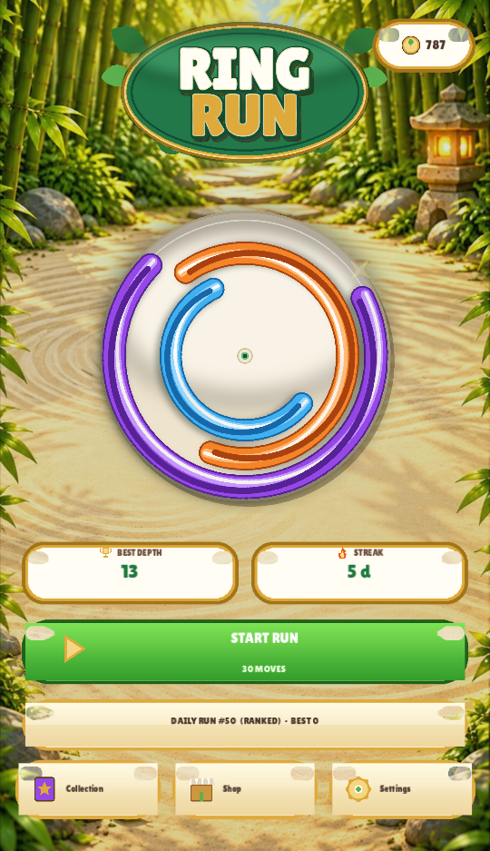

# Ring Run 🎋

> **One move budget. Endless ring puzzles. A new build every run.**

A roguelike re-skin of the Rotate Rings puzzle game, built with **Godot 4.7.2**.

Instead of walking a fixed list of levels, you get one pool of moves for the
whole run. Every ring you turn spends one. Every puzzle you clear gives some
back. When the budget hits zero the run is over — and how deep you got is the
score.



---

## The loop

| | |
|---|---|
| **Start** | 30 moves, budget cap 45 (55 with the Big Tank perk) |
| **Puzzle** | Drawn from a solver-verified pool; every ring you turn costs a move |
| **Clear** | Refill = par × the stage's aura (120% / 100% / 90% / 80%), plus a clean-solve bonus |
| **Boss** | Every 5th puzzle: a Rare or Epic card, +5 moves, 3× coins |
| **Perk choice** | Three cards after every puzzle — a passive perk, or charges for an active power |
| **Danger zone** | Budget ≤ 5: the gauge turns red, the panda panics, the heartbeat starts |
| **Run over** | Budget hits 0 with rings still on the board. One revive (+8 moves) per run |

Six stages — Garden, Grove, Bridge, Temple, Peak, Wilds — each unlocking a
curse (Heavy Ring, Tight Gaps, Blind, One-Way, Locked Ring) and its own
musical scale, so the rings you release play the stage's scale.

There is also a **Daily Run**: the date seeds the puzzles, the card draws and
the curses, so every player worldwide gets the same run.

---

## Running it

```bash
git clone https://github.com/Rushabh9033/ring-run.git
cd ring-run
/Applications/Godot.app/Contents/MacOS/Godot --path .
```

Godot 4.7.2 or newer.

### Headless checks

```bash
./run_headless.sh tests/test_home.gd        # live stats, ring pivot, every action
./run_headless.sh tests/test_run.gd         # budget, clear bonus, refill, run over
./run_headless.sh tests/test_ui.gd          # every screen builds, the board loads
./run_headless.sh tests/test_responsive.gd  # narrow / standard / tall / tablet
```

`run_headless.sh` wraps Godot with a hard timeout and fails fast on compile
errors, so a broken script can never wedge the session.

---

## Layout

```
app/          Services: save, audio, haptics, platform
assets/       Bamboo UI art and the generated Zen Bamboo pack
data/         The solver-verified puzzle pool and the campaign selector
gameplay/     The puzzle model, the perk system and the run controller
run/          Tunables, the stage and curse table
scenes/       The main scene
tests/        Headless proofs
tools/        The asset generator
ui/           Every screen, and RingTheme, the shared style kit
```

### The art

`assets/ui/ring_run_zen/` holds the Zen Bamboo pack: backgrounds, branding,
rings, UI skins, icons and effects. Every asset is generated by
`tools/build_zen_assets.py`, so the whole set can be regenerated or restyled
from one file:

```bash
python3 tools/build_zen_assets.py
```

The rings are filled stadium polygons — one outline per layer, traced in a
single direction — so the caps continue the tube's own shading instead of
reading as beads stuck to the ends. The UI skins are nine-patches whose patch
margins match their corner radius, so a button can be any size without its
rounded ends stretching into an oval.

### The home screen

The rings on the home screen are **decoration**. They are TextureRects on their
own input-ignoring layer and never touch puzzle state. The three share one
1024×1024 canvas and one centre with different radii, so they nest and turn
as a single assembly: purple clockwise at 9s, orange counter-clockwise at 12s,
blue clockwise at 7s. The motion pauses when the menu is hidden or the app is
backgrounded, and resumes from the same angle.

---

## Building

Android and iOS export presets are in `export_presets.cfg`. The app id is
`com.ringrun.game`.

---

## Credits

Game code, art and audio are original to this project. The bamboo and panda
art direction comes from Rotate Rings, the puzzle game this is built on.

Fonts: **Lilita One** and **Fredoka**, both under the SIL Open Font License —
see `assets/fonts/OFL.txt`.
